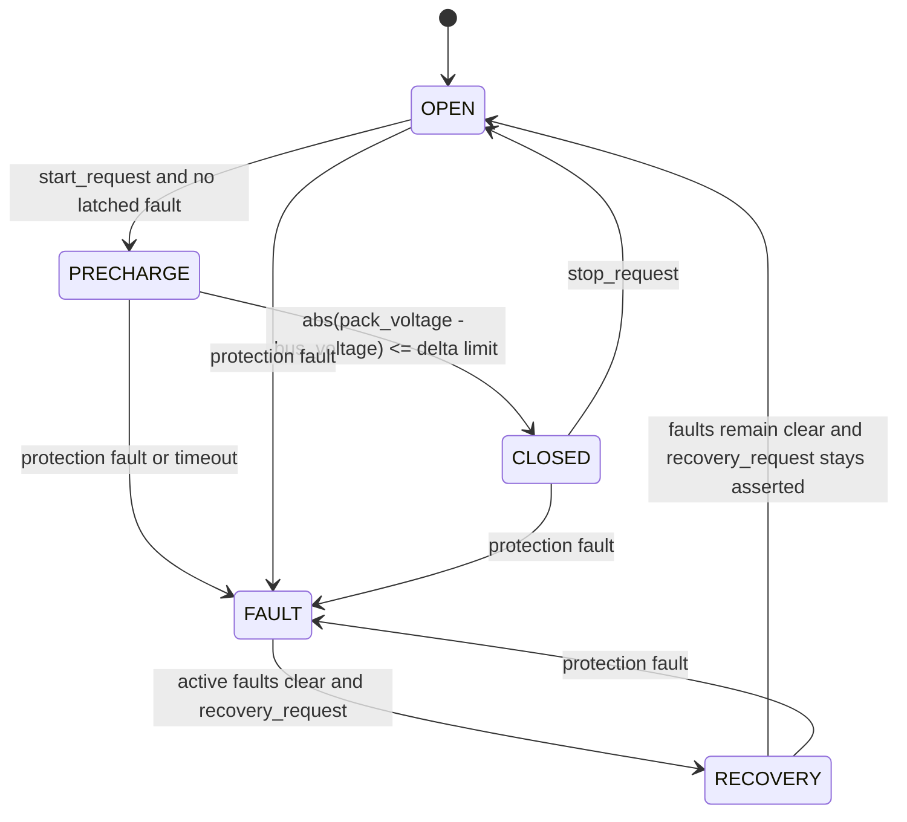
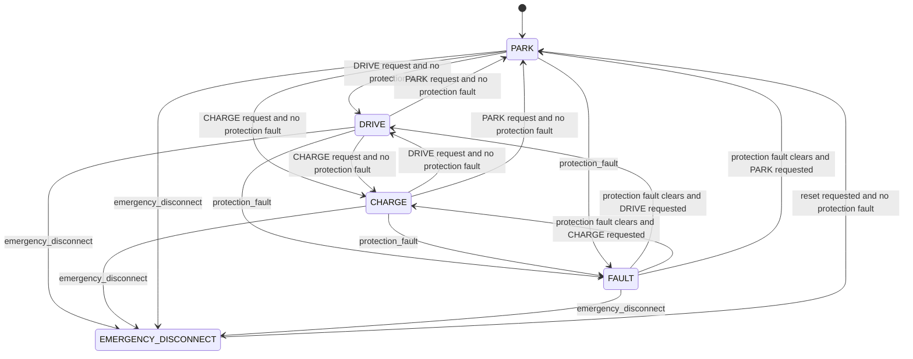

# BDU state machines

The project has two related software state abstractions. They are intentionally
kept separate: the protection BDU controls modeled contactor outputs, while the
operating-mode controller resolves DRIVE/CHARGE/PARK requests and emergency
priority. The balancing supervisor is a separate interlock; `BALANCING` is not
a state in either BDU machine.

## Protection BDU

Protection evaluation has priority over transitions. The implementation uses
these state outputs:

| State | Main contactor | Precharge contactor | Charge/discharge enable |
|---|---:|---:|---:|
| OPEN | Off | Off | Off |
| PRECHARGE | Off | On | Off |
| CLOSED | On | Off | On |
| FAULT | Off | Off | Off |
| RECOVERY | Off | Off | Off |

`FAULT` recovery takes two updates with the recovery request held: one enters
`RECOVERY` after the active faults clear, and a later update returns to `OPEN`.
A new protection fault during recovery returns the controller to `FAULT`.

The Python `ProtectionConfig` defaults are software-test values: UV 2.0 V,
OV 3.6 V, overcurrent 100 A, overtemperature 65 C, precharge delta 2.0 V, and
timeout 5.0 s. They are not approved hardware limits. In particular, the
hardware precharge example uses different illustrative values (3 V and 1 s).
The project's requirements owner must reconcile these before treating them as
system requirements. See `hardware/circuit-definition.md`.

## Operating-mode controller

`DRIVE`, `CHARGE`, and `PARK` are requestable modes. `FAULT` and
`EMERGENCY_DISCONNECT` are outcomes, not requests. Emergency disconnect stays
latched until an explicit reset is accepted with no protection fault. A normal
protection fault overrides the mode only while the fault input is asserted; the
mode controller accepts the next valid mode request after the fault clears. The
separate protection BDU has a latched-fault recovery sequence.

## Verification boundary

Unit tests exercise state transitions and modeled outputs. These machines do
not model contactor coil current, relay motion, arc interruption, analog AFE
filtering, hardware timing, or contact feedback dynamics. The transitions are
software evidence only.
